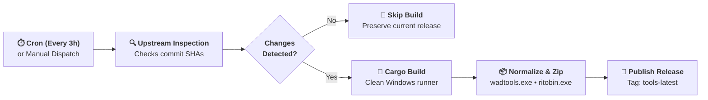

<div align="center">

# vtb-ltk-tools (Windows Binaries for VTB)

**Automated CI/CD pipeline that builds and serves bleeding-edge Windows binaries of League Toolkit (LTK) tools for [Vanilla True Builder](https://github.com/gsmeven/vanilla-true-builder).**

[](https://github.com/gsmeven/vtb-ltk-tools/actions)
[](https://github.com/gsmeven/vtb-ltk-tools/releases/tag/tools-latest)
[](https://www.rust-lang.org/)
[](https://www.microsoft.com/windows)
[](https://github.com/gsmeven/vanilla-true-builder)

</div>

---

## 📖 Overview

**vtb-ltk-tools** is the automated binary supply-chain backbone for **[Vanilla True Builder](https://github.com/gsmeven/vanilla-true-builder)**.

Compiling low-level reverse-engineering tools like `ritobin` and `wadtools` from source requires local Rust/Cargo toolchains, C++ compilers, and platform-specific dependencies. This repository eliminates local build friction by compiling native 64-bit Windows executables directly from upstream source repositories via automated GitHub Actions runners, packaging and serving them through rolling release tags.

---

## 🔄 Automated Pipeline Workflow

The build workflow runs automatically **every 3 hours** or on manual trigger (`workflow_dispatch`):



1. **Upstream Commit Polling:** Checks latest commit SHAs across official [LeagueToolkit](https://github.com/LeagueToolkit) repositories:
   * [`LeagueToolkit/wadtools`](https://github.com/LeagueToolkit/wadtools)
   * [`LeagueToolkit/ritobin-tools`](https://github.com/LeagueToolkit/ritobin-tools)
   * [`LeagueToolkit/league-toolkit`](https://github.com/LeagueToolkit/league-toolkit) (`crates/ltk_ritobin` & `crates/ltk_wad`)
2. **State Verification:** Compares current upstream parser states against the latest published release body. If no relevant commit changes occurred, the job skips compilation to conserve CI resources.
3. **Clean Compilation:** Uses the official Rust stable toolchain on clean GitHub-hosted `windows-latest` virtual environments (`cargo install --git`).
4. **Binary Normalization:** Resolves and renames binary outputs to standardized filenames (`wadtools.exe`, `ritobin.exe`).
5. **Distribution:** Compresses binaries into `tools.zip` and updates the rolling [`tools-latest`](https://github.com/gsmeven/vtb-ltk-tools/releases/tag/tools-latest) release tag with commit provenance metadata.

---

## 🧰 Bundled Binaries

| Binary | Source Repository | Purpose in Vanilla True Builder |
| :--- | :--- | :--- |
| **`wadtools.exe`** | [`LeagueToolkit/wadtools`](https://github.com/LeagueToolkit/wadtools) | High-speed decompression and selective extraction of League `.wad.client` archives. |
| **`ritobin.exe`** | [`LeagueToolkit/ritobin-tools`](https://github.com/LeagueToolkit/ritobin-tools) | Lossless decompilation and recompilation of serialized Riot property trees (`PROP` / `.bin`). |

---

## 🔗 Direct Download & Consumption

Binaries are permanently distributed as a single archive:

* **Direct Archive:** [`tools.zip`](https://github.com/gsmeven/vtb-ltk-tools/releases/download/tools-latest/tools.zip)
* **Release Channel:** [`tools-latest`](https://github.com/gsmeven/vtb-ltk-tools/releases/tag/tools-latest)

**Vanilla True Builder** consumes this archive conditionally at runtime using HTTP `If-None-Match` (ETag) validation, downloading and extracting updated binaries only when a new upstream revision is detected.

---

## 🛡️ Security & Supply-Chain Integrity

* **Zero Opaque Binaries:** No binaries are ever compiled locally or uploaded manually.
* **100% Reproducible:** Every release artifact is built purely by GitHub Actions from public, open-source repositories.
* **Traceable Provenance:** Every release contains the exact upstream commit SHAs used during compilation in its release notes body.

---

## 🤖 Autonomous Pipeline & Maintenance Notice

* **Autonomous Architecture:** This repository is an entirely autonomous, machine-operated infrastructure pipeline. It is **not actively maintained by any human developer**, nor does it accept manual code contributions, issues, or pull requests.
* **AI-Architected:** The orchestration workflows, automation logic, and documentation for this repository were engineered with artificial intelligence assistance.
* **Upstream Mirroring:** The pipeline operates purely as an automated compiler and distribution bridge, monitoring and mirroring official changes directly from the [LeagueToolkit](https://github.com/LeagueToolkit) source repositories without human intervention.

---

## 🌟 Acknowledgements

This CI/CD suite builds upon the foundational reverse-engineering work created and maintained by the **[LeagueToolkit](https://github.com/LeagueToolkit)** organization:

* **[Crauzer](https://github.com/Crauzer)** — Creator of LeagueToolkit and maintainer of LTK archive utilities.
* **[moonshadow565](https://github.com/moonshadow565)** — Pioneer of `ritobin` and the League property serialization format.

---

## ⚖️ License

The compilation pipeline and automation scripts in this repository are licensed under the [GNU General Public License v3.0](LICENSE).  
Underlying compiled utilities retain their respective upstream open-source licenses (GPL-3.0 / MIT).
```
